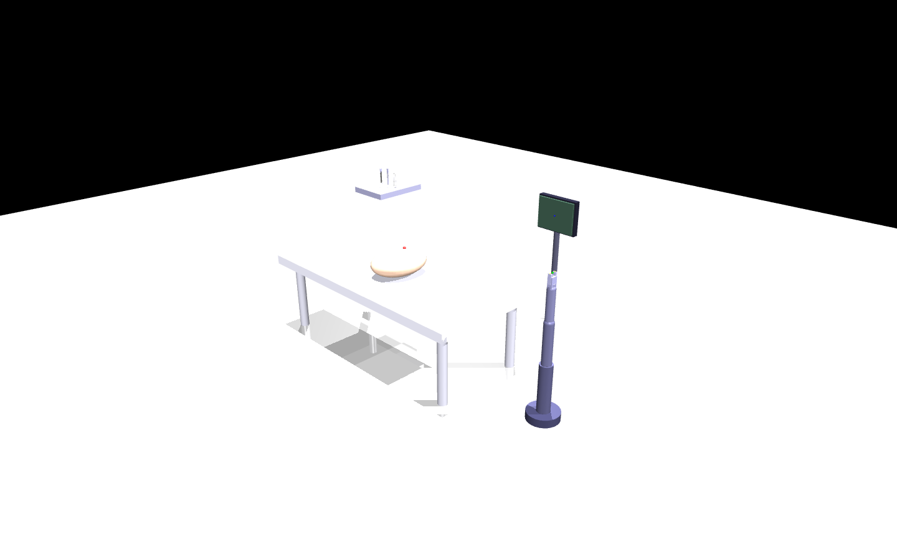

# MuJoCo 医疗机器人仿真

> 一个可交互的医疗机械臂场景，以及带传感器、域随机化和 Gymnasium 接口的强化学习实验环境。

MuJoCo 3.4 · Python · Gymnasium · Stable-Baselines3



## 项目包含什么

- **医疗场景**：6 关节机械臂、手术台、目标点、器械托盘和监护仪。
- **交互控制**：通过键盘控制关节与双指钳口，支持重置和自动演示。
- **23 个传感器元素**：关节位置／速度、力／力矩、触觉、位姿、速度、加速度计和陀螺仪等。
- **Gymnasium 环境**：标准化观察、动作、奖励与回合结束接口。
- **域随机化**：可配置摩擦、质量、关节阻尼和执行器增益随机化。
- **强化学习脚本**：支持 SAC、TD3、PPO，以及检查点、评估和 TensorBoard 日志。

> 这是用于教学与算法原型的仿真项目，不是医疗设备或临床训练系统。

## 快速开始

推荐使用 Python 虚拟环境。基础交互场景只需要 MuJoCo 和 NumPy：

```bash
git clone https://github.com/hahaaa520/mujoco-medical-robot.git
cd mujoco-medical-robot
python -m pip install "mujoco>=3.4.0" "numpy>=1.24.0"
python run_advanced.py
```

如果只需要原始基础场景：

```bash
python run_medical_scene.py
```

如需 Gymnasium 环境和强化学习功能，再安装完整依赖：

```bash
python -m pip install -r requirements.txt
python medical_robot_env.py
```

Linux／macOS 也可以运行 `./start.sh` 选择模式。脚本只检查依赖，不会自动修改系统 Python 环境。

## 交互控制

| 按键 | 功能 |
| --- | --- |
| Q / A | 底座旋转 |
| W / S | 肩部关节 |
| E / D | 肘部关节 |
| R / F | 腕部旋转 |
| T / G | 左侧钳口 |
| Y / H | 右侧钳口 |
| M | 高级场景中切换手动／自动模式 |
| P | 高级场景中打印传感器数据 |
| Space | 重置场景 |
| Esc | 退出 |

鼠标可旋转、平移和缩放视角。

## 强化学习

```bash
# 随机策略基线演示，不代表训练成果
python train_rl.py --mode demo --n_episodes 3

# 训练 SAC
python train_rl.py --mode train --algorithm SAC --timesteps 500000 --n_envs 4

# 评估已保存模型
python train_rl.py --mode evaluate --model_path models/SAC/best_model.zip --n_episodes 20

# 查看训练日志
tensorboard --logdir logs/
```

仓库不附带已训练模型、成功率或 Sim-to-Real 实验结果。训练与评估数据应以你本地运行输出为准。

## 文件入口

| 文件 | 用途 |
| --- | --- |
| `run_advanced.py` | 推荐的高级交互场景 |
| `medical_scene_advanced.xml` | 带传感器的高级模型 |
| `medical_robot_env.py` | Gymnasium 环境、传感器读取与域随机化 |
| `train_rl.py` | SAC／TD3／PPO 训练、评估与随机策略演示 |
| `run_medical_scene.py` | 原始基础场景入口 |
| `medical_scene.xml` | 原始基础模型 |
| `tools/render_preview.py` | 无交互窗口渲染 README 预览图 |
| `docs/ADVANCED.md` | 环境接口、训练配置与自定义说明 |

`medical_scene_fixed.xml` 作为历史场景变体保留，不是默认入口。

## 重新生成预览图

预览图由仓库中的高级 XML 场景实际渲染，不是概念插画：

```bash
python -m pip install pillow
python tools/render_preview.py
```

## 参考文档

- [高级使用与自定义](docs/ADVANCED.md)
- [MuJoCo 文档](https://mujoco.readthedocs.io/)
- [Gymnasium 文档](https://gymnasium.farama.org/)
- [Stable-Baselines3 文档](https://stable-baselines3.readthedocs.io/)

## License

本项目代码与场景文件采用 [MIT License](LICENSE)。MuJoCo、Gymnasium、Stable-Baselines3 及其他第三方内容分别遵循各自许可证。
